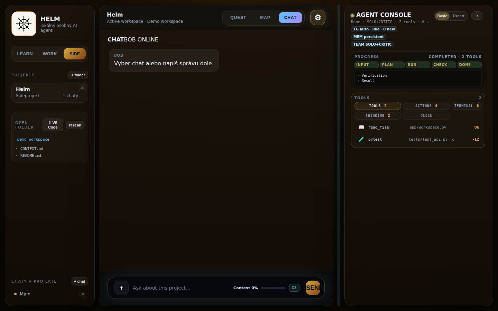

# Helm

**A local-first workspace for supervised AI-agent work.**

Helm brings projects, goals, files, chats, and agent runs into one workspace. I built it to make an agent's work inspectable: runs move through explicit stages, produce reviewable artifacts, and stop for approval when they would cross an external-action boundary.

> Personal project; designed for a single local user. It is not a hosted multi-tenant service.



## What it does

- Organizes projects, chats, local folders, goals, and daily plans.
- Runs staged workflows: **Input → Plan → Execute → Review → Final output**.
- Shows run events, tool activity, artifacts, terminal output, and code diffs in the Agent Console.
- Applies deterministic context tiers (XS/S/M/L) so simple questions do not receive the same context as multi-file work.
- Keeps review and approval gates around failed checks and external actions.
- Deletes Helm-managed project records without recursively deleting the user's workspace folder.

## Built with

- **Backend:** Python, FastAPI, SQLite
- **Frontend:** vanilla JavaScript, HTML, CSS
- **Tests:** pytest, httpx, pytest-asyncio
- **Optional runtime:** a locally configured Hermes-compatible command; no provider credentials are stored in this repository.

## Run locally

Requires Python 3.11+ and Node.js for the JavaScript syntax check.

```bash
python3 -m venv .venv
source .venv/bin/activate
python -m pip install -r requirements.txt -r requirements-dev.txt
mkdir -p .local

BOB_WORKSPACE_DB="$PWD/.local/helm.db" \
HELM_WORKSPACE_ROOT="$PWD/.local/workspace" \
HELM_SHARED_UI_ROOT="$PWD/shared-ui" \
python -m uvicorn app.main:app --host 127.0.0.1 --port 8000
```

Open <http://127.0.0.1:8000/>. This example keeps data under the Git-ignored `.local/` directory; for a separate data location, set `HELM_DATA_HOME`, `BOB_WORKSPACE_DB`, and `HELM_WORKSPACE_ROOT`. Set `HELM_RUNTIME_COMMAND` to your local Hermes-compatible command if you want to start real agent runs. Tests use isolated databases and fake runtimes; they do not need provider credentials.

## Verify

```bash
pytest -q
node --check shared-ui/app.js
```

## Architecture

See [docs/ARCHITECTURE.md](docs/ARCHITECTURE.md) for the component map and [docs/SECURITY.md](docs/SECURITY.md) for local-data and runtime boundaries.

## Project notes

This public snapshot contains the application source and tests, but omits maintainer-specific deployment instructions, private operational notes, local prompt examples, and the original development history. That history included machine-specific paths and network details, so this repository starts with a clean public history.

## License

MIT. See [LICENSE](LICENSE).

## Author

Filip Duda · [GitHub](https://github.com/menamefilip)
