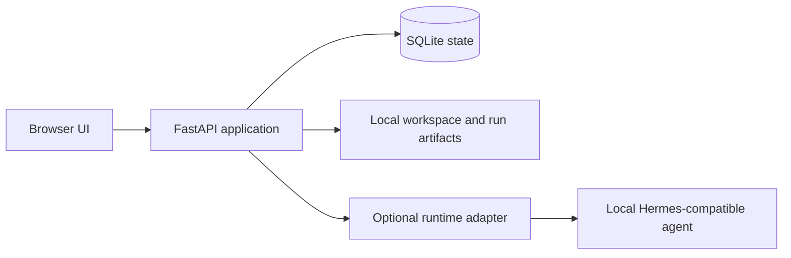

# Architecture

Helm is a local-first web application with four main parts:

## Application flow

1. The browser loads the static UI from `shared-ui/` and calls the FastAPI API.
2. FastAPI stores projects, chats, messages, run stages, events, settings, and review state in SQLite.
3. Project files and run artifacts live in a user-selected workspace directory.
4. If configured, the runtime adapter passes a prepared run input to a local agent command and records its output and events.
5. The UI presents progress and artifacts so the user can inspect the result before accepting it.

## Boundaries

- The database and workspace are local to the machine running Helm.
- The agent runtime is an optional adapter; provider credentials are not part of this repository.
- Review/approval state is separate from runtime execution state. A completed process is not automatically permission to perform an external action.
- The current product is designed for one trusted local user. It does not provide multi-user authentication or a hosted tenant boundary.

## Main code areas

- `app/main.py`: API routes, run orchestration, and runtime lifecycle.
- `app/db.py`: SQLite schema and migrations.
- `app/workspace.py`: project files, context selection, and runtime contracts.
- `app/schemas.py`: request validation.
- `shared-ui/`: browser interface and styles.
- `tests/`: API, lifecycle, context, UI wiring, and safety regressions.
